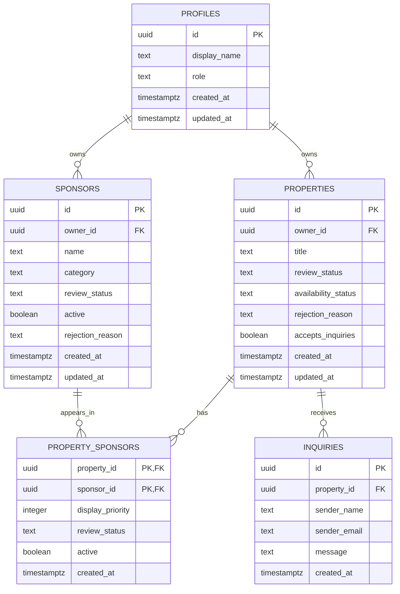

# Database Design

## Purpose

This database supports property submission and approval, sponsor-profile
approval, property-sponsor placements, public inquiries, and row-level
security. All development and seed records are fictional.

## Entity Relationship Diagram

## Relationships

- One profile may own multiple properties.
- One profile may own multiple sponsor records.
- Properties and sponsors have a many-to-many relationship through
  `property_sponsors`.
- One property may receive multiple inquiries.
- Inquiry access is determined through the property's `owner_id`.

## Status Separation

Property approval and market availability are separate concepts:

- `review_status`: `draft`, `pending_review`, `rejected`, `approved`, `archived`
- `availability_status`: `available`, `pending`, `sold`

Sponsor approval and activity are also separate:

- `review_status` controls whether sponsor content is approved.
- `active` controls whether approved content is currently displayed.

## Ownership and Authorization

- Property professionals manage only properties where `owner_id` matches their
  authenticated profile.
- Sponsors manage only sponsor records where `owner_id` matches their profile.
- Owners cannot assign themselves administrative roles or approve their own
  content.
- Administrative approval is performed through trusted server code.
- Public users cannot read stored inquiries.
- Property owners may read inquiries associated with their own properties.

## Public Visibility

A property is publicly visible only when its review status is `approved`.

A sponsor placement is publicly visible only when:

1. The property is approved.
2. The sponsor is approved and active.
3. The property-sponsor relationship is approved and active.

## Recorded MVP Assumptions

- Visitors may submit inquiries without signing in.
- Anonymous users cannot retrieve stored inquiries.
- Material edits return approved content to `pending_review`.
- Shared-office inquiry routing is deferred.
- Properties with inquiries cannot be deleted through ordinary owner actions.
- Public routes return an explicit allowlist of fields instead of complete
  database records.
  