# Digital asset audit screenshot evidence

Captured by Aaron De Robles during the local audit on November 1, 2026 (Pacific Time). Uploaded filenames use November 2 timestamps.

Browser chrome was cropped from copies to remove unrelated tabs, bookmarks, and profile details. The underlying app, DevTools values, and database evidence were not altered. Terminal screenshots omit identity prompts. Original uploads remain unchanged.

## Evidence index

| File | What it verifies | Original upload |
| --- | --- | --- |
| [01-desktop-1280-final-layout.png](01-desktop-1280-final-layout.png) | Viewport 1280; property 345.06px; sponsor 1182.4px; icon 24px. | `image(20261102-015344).png` |
| [02-mobile-390-final-widths.png](02-mobile-390-final-widths.png) | Viewport 390; property 308.8px; sponsor 308.8px; icon 24px. | `image(20261102-015536).png` |
| [03-sponsor-response-headers.png](03-sponsor-response-headers.png) | image/webp; Content-Length 62800 bytes; optimized-image cache HIT. | `image(20261102-015700).png` |
| [04-property-response-headers.png](04-property-response-headers.png) | image/webp; Content-Length 52300 bytes; optimized-image cache HIT. | `image(20261102-015725).png` |
| [05-property-content-download.png](05-property-content-download.png) | 10.31 ms Content Download; 39.31 ms panel total. | `image(20261102-015753).png` |
| [06-sponsor-content-download.png](06-sponsor-content-download.png) | 22.41 ms Content Download; 50.26 ms panel total. | `image(20261102-015805).png` |
| [07-icon-response-headers.png](07-icon-response-headers.png) | image/svg+xml; Content-Length 395 bytes. | `image(20261102-015943).png` |
| [08-icon-content-download.png](08-icon-content-download.png) | 0.98 ms Content Download; 21.02 ms panel total. | `image(20261102-015952).png` |
| [09-mobile-network-transfers.png](09-mobile-network-transfers.png) | HTTP 200 for all three; transferred sizes 52.7 kB property, 63.2 kB sponsor, 0.7 kB icon. | `image(20261102-020021).png` |
| [10-local-administrative-approvals.png](10-local-administrative-approvals.png) | All three APPROVED; Aaron De Robles; timestamp 2026-11-02 02:29:24.422992+00. Notes are truncated in the screenshot; use the CSV for complete notes. | `image(20261102-022945).png` |
| [11-database-tests-pass-before-formatting.png](11-database-tests-pass-before-formatting.png) | 36 tests passed. Later lines show the formatting errors before correction; this is not evidence of a clean whitespace check or asset-specific tests. | `image(20261102-023404).png` |
| [12-whitespace-check-clean.png](12-whitespace-check-clean.png) | git diff --check has no output; status shows intended component/assets/migration changes and untracked snippets. | `image(20261102-023831).png` |

## Measurement interpretation

- Widths are rendered CSS pixels, not the requested bitmap widths. Device pixel ratio was approximately 2.
- Final width captures used 390 × 608 and 1280 × 1216 viewports; the audit comparison concerns width.
- Mobile network evidence uses Chrome with browser cache disabled and no throttling. Photographs came from the server's existing optimization cache.
- Content-Length is the body length, not transferred bytes including response overhead.
- The Time column and Timing-panel total are not Content Download. Screenshots are separate captures; do not reconcile different totals as if they were one identical request.
- Approval evidence is local, and the register is not used as a runtime rendering gate.
- These 36 tests are the existing database suite, not dedicated tests of asset_reviews.
- Earlier incorrect-width and unpadded-banner captures are deliberately excluded.

## Related files

- [Approval CSV](../asset-approvals.csv) — already saved in the repository; not recreated in this bundle.
- [Full audit](../../digital-asset-audit.md) — previously drafted; keep in the repository.

## Screenshot gallery

### Final desktop layout and widths

Viewport 1280; property 345.06px; sponsor 1182.4px; icon 24px.

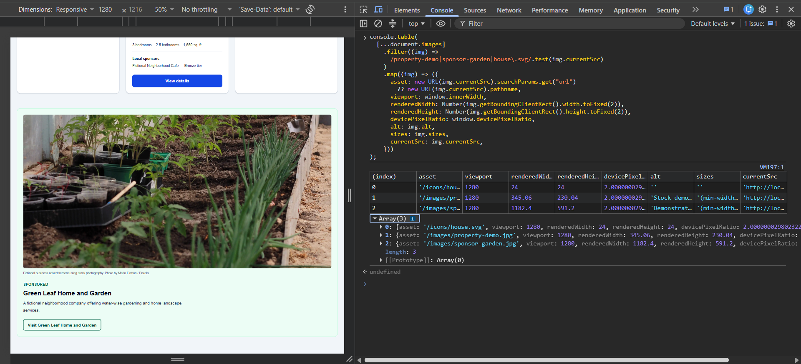

### Final mobile widths

Viewport 390; property 308.8px; sponsor 308.8px; icon 24px.

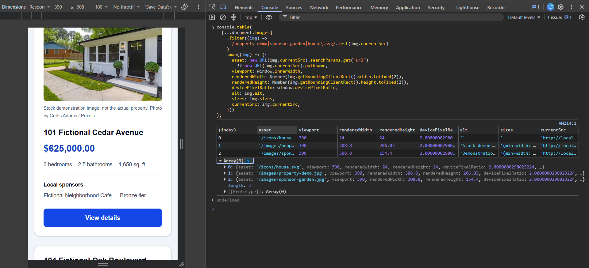

### Sponsor response headers

image/webp; Content-Length 62800 bytes; optimized-image cache HIT.

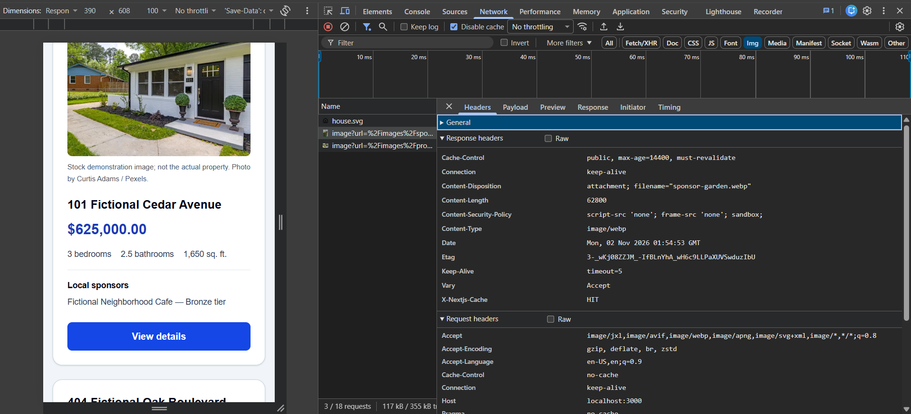

### Property response headers

image/webp; Content-Length 52300 bytes; optimized-image cache HIT.

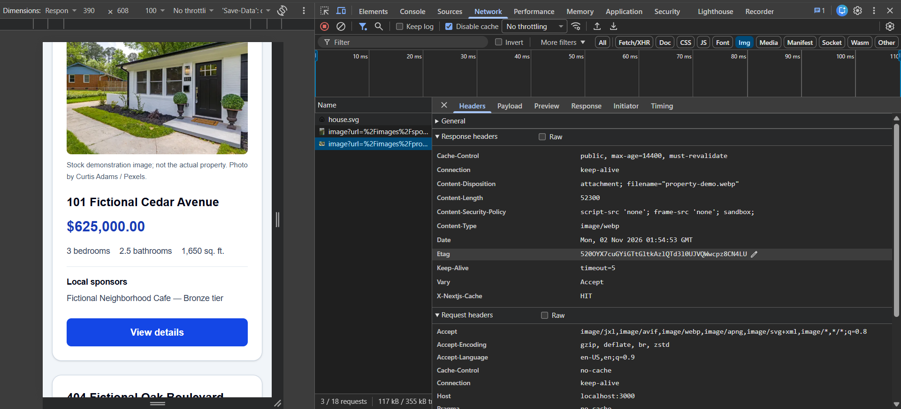

### Property Content Download

10.31 ms Content Download; 39.31 ms panel total.

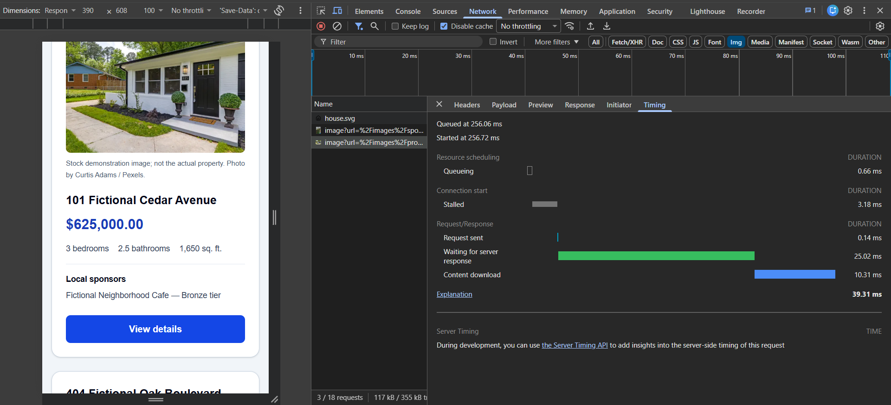

### Sponsor Content Download

22.41 ms Content Download; 50.26 ms panel total.

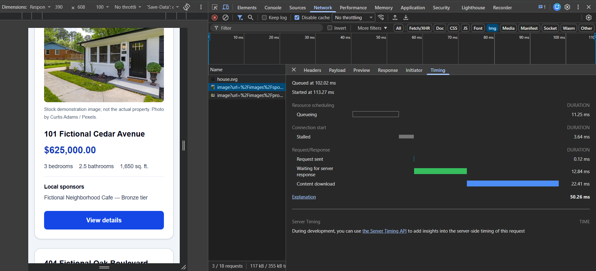

### Icon response headers

image/svg+xml; Content-Length 395 bytes.

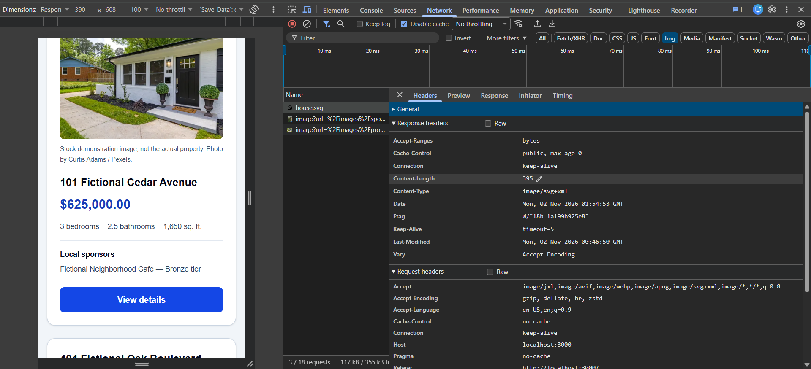

### Icon Content Download

0.98 ms Content Download; 21.02 ms panel total.

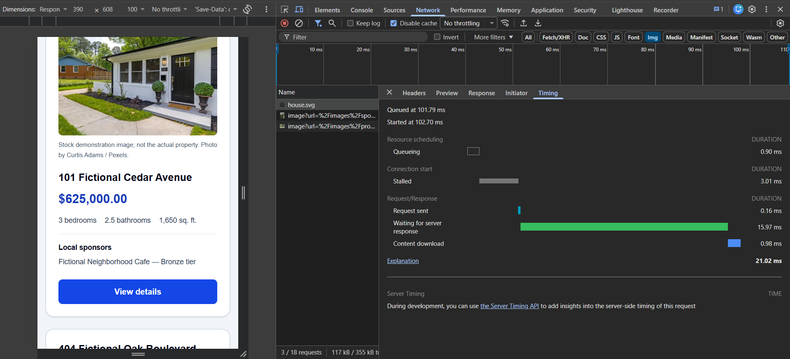

### Network overview

HTTP 200 for all three; transferred sizes 52.7 kB property, 63.2 kB sponsor, 0.7 kB icon.

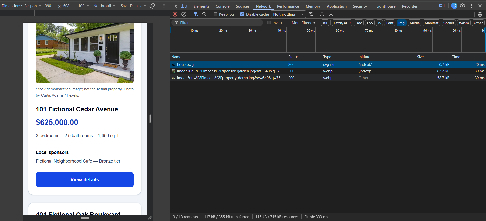

### Local approval records

All three APPROVED; Aaron De Robles; timestamp 2026-11-02 02:29:24.422992+00. Notes are truncated in the screenshot; use the CSV for complete notes.

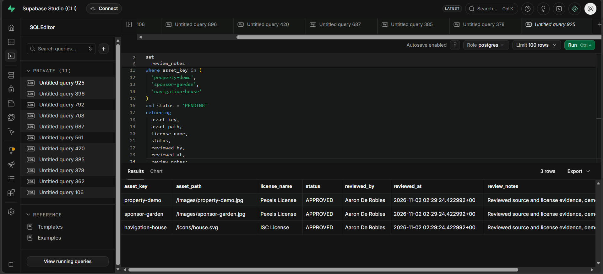

### Existing database tests

36 tests passed. Later lines show the formatting errors before correction; this is not evidence of a clean whitespace check or asset-specific tests.

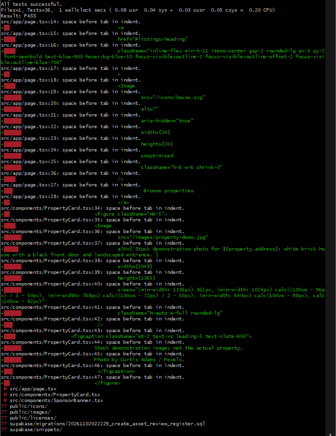

### Final whitespace check and status

git diff --check has no output; status shows intended component/assets/migration changes and untracked snippets.

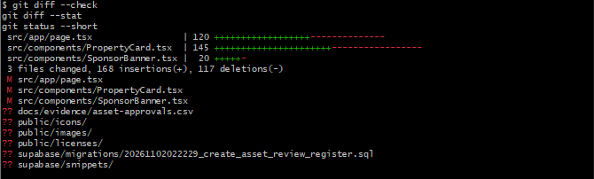
